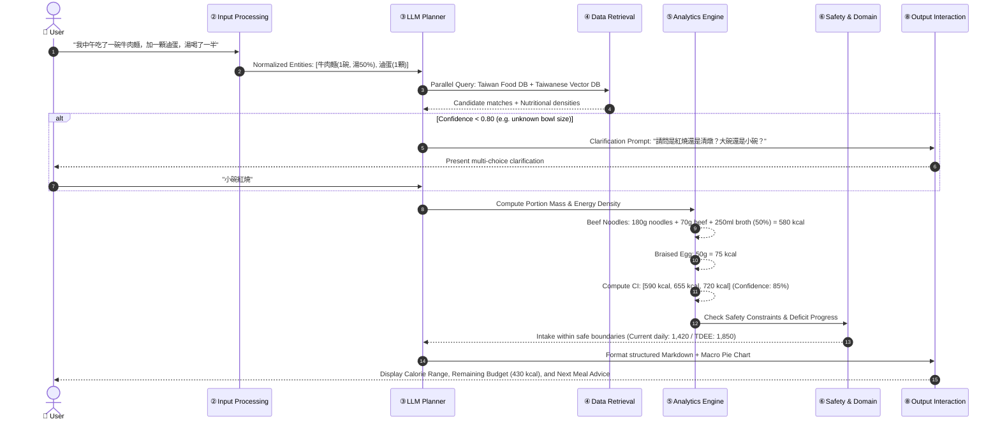

# DietSense: System Design Document (系統設計文件)

> **Document Version:** 1.0.0 (Proposal & Spec-Driven Phase)  
> **Course:** DIC3 Final Project Proposal / Project Refactor  
> **Framework:** OpenSpec Spec-Driven Development  
> **Core Architecture:** Domain AI Agent + Domain Knowledge + Data Analytics + Real-World Health Application  
> **Primary Target:** Taiwanese Cuisine & Context-Aware Calorie and Nutritional Management  

---

## 1. Problem Definition & Research Context

### 1.1 Public Health Urgency
According to the World Health Organization (WHO, 2024), over 2.6 billion adults worldwide are overweight, with 940 million living with obesity. In Taiwan, official data from the Health Promotion Administration (衛生福利部國民健康署) indicates that 47.9% of adults aged 18+ are overweight or obese, contributing to over NT$500 billion in annual medical expenditures.

### 1.2 Cognitive Barriers of Existing Solutions
While consistent dietary tracking doubles the probability of achieving weight loss goals (Teixeira et al., 2025), traditional applications suffer from severe friction:
1. **Manual Data Entry Burden:** Searching across 10,000+ database rows and decomposing composite dishes causes 85% of users to abandon tracking within 30 days (Helander et al., 2014; SMARTER Trial, 2024).
2. **High Self-Report Error (18%–54%):** Portion sizes, hidden cooking oils, and mixed dishes produce systematic underreporting (Poslusna et al., 2009).
3. **General LLM Hallucinations:** Direct prompt-based calorie queries to ungrounded LLMs exhibit a Mean Absolute Percentage Error (MAPE) of 35.8% and systematic underestimation of large portions (Cheng et al., 2024).
4. **Lack of Taiwanese Food Specialization:** Western databases (e.g., USDA) lack representative coverage of Taiwanese night market foods, lunchboxes (便當), composite soups, and customizable beverages (手搖飲).

---

## 2. Requirements & OpenSpec Traceability

| Req ID | Category | Requirement Description | Acceptance Criteria & Target Metric | Spec Mapping |
|---|---|---|---|---|
| **REQ-01** | Functional | Natural Language Meal Logging in Traditional Chinese | End-to-end logging from casual Chinese description within $\le 60\text{ s}$ | `spec:TM-3`, `DR-02` |
| **REQ-02** | Functional | Clarification Loop for Ambiguous Food & Portion | Triggered when confidence $< 0.80$; max 1 round, $\le 2$ questions | `spec:TO-1`, `DR-03` |
| **REQ-03** | Functional | Multi-Source Nutrition Retrieval (USDA + Taiwan DB + Vector RAG) | $\ge 90\%$ coverage on top 100 Taiwanese night market foods | `spec:BDI`, `DR-08` |
| **REQ-04** | Functional | Personalized TDEE/BMR Computation | Implements Mifflin-St Jeor equation; updates dynamic deficit | `spec:TM-1`, `TM-4`, `DR-09` |
| **REQ-05** | Functional | Uncertainty Quantification (Confidence Intervals) | Output $CI = \hat{E} \pm \text{Margin}$ instead of single false precision | `spec:TM-3`, `DR-02` |
| **REQ-06** | Safety | Absolute Caloric Floor Interception | Intercepts targets $< 1,200\text{ kcal/day}$ with mandatory warning | `spec:DR-10`, `TO-2` |
| **REQ-07** | Safety | Binge-Restrict Pattern Detection | Identifies $>1,000\text{ kcal}$ cyclical swings; suggests dietitian support | `spec:DR-10` |
| **REQ-08** | Non-Functional | Caloric Estimation Accuracy | $\ge 85\%$ of test meals within $\pm 20\%$ of gold standard | `spec:Evaluation` |
| **REQ-09** | Non-Functional | System Usability Scale (SUS) Score | SUS score $> 70$ in 20-person $\times$ 7-day user trial | `spec:Evaluation` |
| **REQ-10** | Non-Functional | Response Latency | P95 latency $< 3.0\text{ s}$ for standard retrieval and inference | `spec:NFR` |

---

## 3. Eight-Module System Architecture (八大系統模組)

DietSense enforces the principle of **"LLM for Orchestration & Understanding; Domain Tools for Computation & Safety"**.

```mermaid
graph TD
    subgraph M1["① User/Application Scenario (使用情境)"]
        A1["Mobile Chat UI"]
        A2["Web Dashboard"]
        A3["LINE Bot Integration"]
    end

    subgraph M2["② Query/Input Processing (輸入前處理)"]
        B1["Whisper STT (Speech-to-Text)"]
        B2["Traditional/Simplified Normalizer"]
        B3["Intent Classifier (log_food / query / analyze / recommend)"]
    end

    subgraph M3["③ Planner & Reasoning Agent (推理核心)"]
        C1["LLM Coordinator (GPT-4o / Gemini 1.5 Pro)"]
        C2["Multi-turn Memory Buffer"]
        C3["Food Named Entity Extractor (NER)"]
        C4["Clarification Loop Trigger"]
    end

    subgraph M4["④ Data Acquisition & Retrieval (資料取得)"]
        D1["USDA FoodData Central API (900k+ items)"]
        D2["Taiwan Food Composition DB (衛福部 6k+ items)"]
        D3["Taiwanese Cuisine Vector DB (RAG)"]
        D4["User Dietary History Store (SQLite/PostgreSQL)"]
    end

    subgraph M5["⑤ Analytics Engine (分析計算引擎)"]
        E1["Deterministic Calorie Density Engine"]
        E2["Macronutrient Ratio Analyzer (P/C/F)"]
        E3["Mifflin-St Jeor BMR & TDEE Calculator"]
        E4["Uncertainty Quantification Module (CI)"]
    end

    subgraph M6["⑥ Domain Knowledge Integration (領域知識庫)"]
        F1["Taiwan Daily Dietary Guidelines (每日飲食指南)"]
        F2["Standard Portion Heuristics KB"]
        F3["Clinical Safety Rules (<1200 kcal / Binge Flags)"]
        F4["Nutritional Substitution KB"]
    end

    subgraph M7["⑦ Decision & Recommendation (決策建議)"]
        G1["Daily Energy Balance & Deficit Tracking"]
        G2["Target Gap & Meal Adjustment Guidance"]
        G3["Clinical Escalation & Safety Alerts"]
    end

    subgraph M8["⑧ Output & Interaction (輸出互動)"]
        H1["Structured Markdown Report"]
        H2["Macronutrient Pie Chart & Visual CI"]
        H3["Longitudinal Trend Visualizer"]
    end

    M1 --> M2
    M2 --> M3
    M3 -->|Tool Call| M4
    M4 --> M5
    M5 --> M6
    M6 --> M7
    M7 --> M8
    M8 --> M1
    M3 -.->|Confidence < 0.80: Clarification Question| M1
```



---

## 4. End-to-End Workflow & Data Flow (端到端工作流)



---

## 5. Core Mathematical & Computational Formulations

### 5.1 Calorie & Portion Mass Calculation
$$\text{Calorie Point Estimate: } \hat{E} = \sum_{i=1}^{N} \left( \text{Mass}_i (\text{g}) \times \frac{\text{kcal\_per\_100g}_i}{100} \right)$$
$$\text{Macronutrient Mass: } M_k = \sum_{i=1}^{N} \left( \text{Mass}_i (\text{g}) \times \frac{\text{macro}_{k,i}}{100} \right), \quad k \in \{\text{Protein, Carbs, Fat}\}$$

### 5.2 Confidence Interval & Uncertainty Propagation
Let $c \in [0.0, 1.0]$ be the composite match confidence score based on entity specificity and retrieval cosine distance. The margin of uncertainty $M_{err}$ is formulated as:
$$M_{err} = \hat{E} \times \left( 0.10 + (1 - c) \times 0.50 \right)$$
$$\text{Confidence Interval: } CI = \left[ \hat{E} - M_{err}, \; \hat{E} + M_{err} \right]$$
*When $c \ge 0.90$, margin is $\approx \pm 15\%$; when $c = 0.60$, margin widens to $\pm 30\%$, triggering clarification.*

### 5.3 Basal Metabolic Rate (BMR) & Total Daily Energy Expenditure (TDEE)
Using the validated Mifflin-St Jeor predictive equations:
$$\text{BMR}_{\text{male}} = 10 \times W (\text{kg}) + 6.25 \times H (\text{cm}) - 5 \times A (\text{years}) + 5$$
$$\text{BMR}_{\text{female}} = 10 \times W (\text{kg}) + 6.25 \times H (\text{cm}) - 5 \times A (\text{years}) - 161$$
$$\text{TDEE} = \text{BMR} \times \text{PAL}$$
where Physical Activity Level ($\text{PAL}$) is categorized into:
- Sedentary (久坐): $1.20$
- Lightly Active (輕度活動，每週輕度運動 1–3 天): $1.375$
- Moderately Active (中度活動，每週中度運動 3–5 天): $1.55$
- Very Active (高活動量，每週高強度運動 6–7 天): $1.725$

---

## 6. Algorithmic Pseudocode (帶行號之核心演算法)

```python
"""
Algorithm 1: DietSense End-to-End Conversational Calorie & Nutrition Agent
Input : User Query Q (string), User Profile P (dict), Daily Log D (DailyLog)
Output: Formatted Response R (ResponseObject), Updated Daily Log D'
"""

01: def diet_agent(Q: str, P: UserProfile, D: DailyLog) -> tuple[ResponseObject, DailyLog]:
02:     # Step 1: Input Normalization & Multi-lingual Handling
03:     Q_norm = normalize_text(Q)  # Traditional Chinese normalization, colloquialisms
04:     
05:     # Step 2: Intent Classification
06:     intent = classify_intent(Q_norm)  # log_food | query_nutrition | analyze | recommend
07:     
08:     # Step 3: Intent Branching
09:     if intent == "log_food":
10:         entities = extract_food_entities(Q_norm)  # FoodNER: items, portions, context
11:         for item in entities:
12:             # Step 4: Multi-source Retrieval
13:             candidates = []
14:             candidates += query_taiwan_food_db(item.name)
15:             candidates += query_taiwanese_vector_rag(item.name, item.context)
16:             candidates += query_usda_api(item.name)
17:             
18:             # Step 5: Candidate Ranking & Confidence Scoring
19:             best_match, confidence = rank_candidates(candidates, item.context)
20:             
21:             # Step 6: Clarification Loop Decision
22:             if confidence < 0.80 and not item.is_clarified:
23:                 clarification_prompt = generate_clarification_question(item, candidates[:3])
24:                 return await request_user_clarification(clarification_prompt), D
25:             
26:             # Step 7: Deterministic Computation & Uncertainty Quantification
27:             portion_grams = resolve_portion_mass(item.portion_desc, best_match)
28:             kcal_point = portion_grams * (best_match.kcal_per_100g / 100.0)
29:             kcal_low, kcal_high = compute_confidence_interval(kcal_point, confidence)
30:             macros = compute_macronutrients(portion_grams, best_match)
31:             
32:             # Step 8: Update Daily Log
33:             D.append_entry(
34:                 food=best_match.name,
35:                 portion_g=portion_grams,
36:                 kcal=(kcal_low, kcal_point, kcal_high),
37:                 macros=macros,
38:                 timestamp=get_current_time()
39:             )
40:     
41:     # Step 9: Analytics & Energy Balance Tracking
42:     daily_kcal_point = sum(e.kcal[1] for e in D.entries)
43:     bmr = calculate_bmr_mifflin(P.weight, P.height, P.age, P.gender)
44:     tdee = bmr * P.activity_level
45:     remaining_deficit = tdee - daily_kcal_point
46:     
47:     # Step 10: Clinical Safety Guardrail Evaluation
48:     safety_status = evaluate_safety(D, P)
49:     if safety_status == "DANGER_SEVERE_RESTRICTION":  # <1,200 kcal target
50:         alert_msg = generate_safety_alert(type="LOW_CALORIE_CEILING")
51:         return format_response(alert=alert_msg, block_further_restriction=True), D
52:     elif safety_status == "WARNING_BINGE_RESTRICT":
53:         alert_msg = generate_safety_alert(type="BINGE_RESTRICT_PATTERN")
54:     else:
55:         alert_msg = None
56:     
57:     # Step 11: Multi-modal Response Construction
58:     R = format_response(
59:         daily_log=D,
60:         calorie_summary=(daily_kcal_point, tdee, remaining_deficit),
61:         macronutrient_ratios=compute_macro_ratios(D),
62:         safety_alert=alert_msg,
63:         charts=generate_visual_artifacts(D)
64:     )
65:     return R, D
```

---

## 7. OpenSpec Directory Layout & Component Mapping

```text
dic3/
├── .agents/skills/              # OpenSpec shared agent skills (propose, apply, sync, etc.)
├── openspec/
│   ├── config.yaml              # OpenSpec configuration & domain constraints
│   └── changes/
│       └── dietsense-proposal-refactor/
│           ├── .openspec.yaml   # Change metadata
│           ├── proposal.md      # Refactor proposal & scope definition
│           ├── specs/
│           │   └── dietsense-agent/
│           │       └── spec.md  # Core capability specifications (5 TM, 3 TO, 10 DR)
│           ├── design.md        # Detailed 8-module architectural design & workflow
│           └── tasks.md         # W1–W8 milestone implementation task breakdown
├── myplan/
│   ├── 2026-11-11-DietSense-conversation-plan.md  # Historical conversation & decision log
│   ├── A-to-F-5C-3T-10D.md                         # Detailed A-to-F, 5 Cores, 3 Trade-offs, 10 Details
│   ├── introduction-refactor.md                   # Refactored Introduction (IEEE Transaction style)
│   ├── related-work-refactor.md                   # Refactored Related Work (1/2 AI + 1/2 Domain)
│   ├── 期中Proposal_熱量AI_Agent-文字擷取.md          # Raw transcript of original mid-term proposal
│   ├── 期末專題提案作業規範-文字擷取.md              # Course proposal grading specifications
│   └── 熱量AI提案解析-文字擷取.md                   # NotebookLM analysis & A2Z SOP mapping
├── DESIGN.md                                      # This official system design document
└── README.md                                      # Project overview, quickstart & documentation
```

---

## 8. Evaluation Framework & Expected Outcomes

### 8.1 Benchmark Datasets
- **Taiwanese Cuisine Corpus (500 Annotations):** 500 annotated Traditional Chinese natural language meal logs covering night market snacks (20%), bento boxes (25%), noodle dishes & soups (20%), mixed stir-fries (15%), and beverages (20%).
- **Public Reference Databases:** USDA FoodData Central (900,000+ items), Taiwan Ministry of Health and Welfare Food Composition Database (6,000+ items).

### 8.2 Baseline & Evaluation Metrics
- **Baseline:** Commercial manual search logging standard (MyFitnessPal).
- **Primary Metrics:**
  - **Calorie Estimation Accuracy ($\pm 10\%, \pm 20\%$ margin):**
    $$\text{Accuracy}_{\pm 20\%} = \frac{1}{N} \sum_{i=1}^{N} \mathbb{I}\left( \left| \frac{\hat{E}_i - E_i^*}{E_i^*} \right| \le 0.20 \right) \ge 85\%$$
  - **Interaction Time Reduction:** Average logging time per meal reduced from ~180s to $<60\text{s}$ ($\ge 60\%$ speedup).
  - **Usability (SUS):** System Usability Scale score $> 70$ across a 20-participant $\times$ 7-day field trial.
  - **Safety Interception Rate:** $100\%$ interception on queries attempting $<1,200\text{ kcal/day}$ targets.

---

## 9. Limitations & Ethical Safeguards

1. **Self-Report Inherent Bias:** Natural language logging remains bounded by user transparency; omission of consumed snacks cannot be detected without continuous physiological sensing.
2. **Medical Disclaimer:** DietSense is a behavioral weight management decision-support system, **not a medical device**. It explicitly disclaims diagnostic authority and enforces mandatory clinical referral triggers for high-risk populations (eating disorder history, pregnancy, severe chronic renal/cardiovascular diseases).
