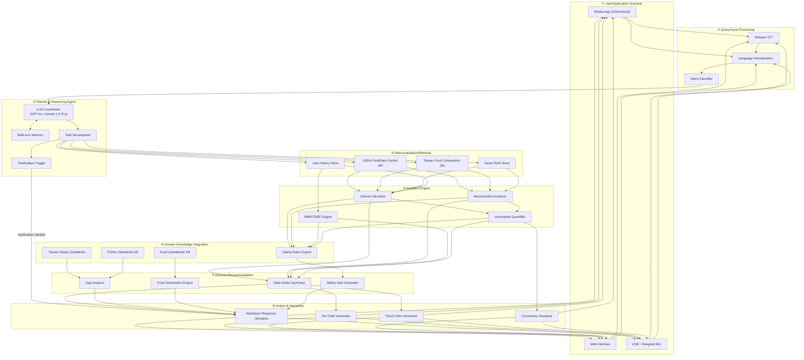
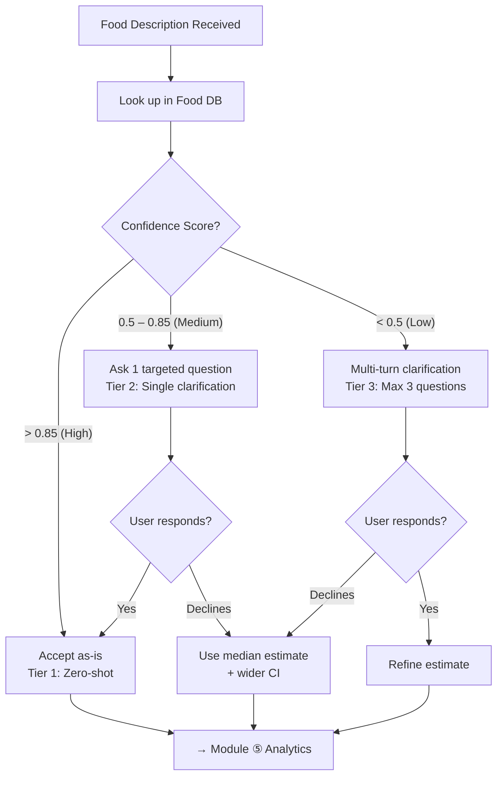
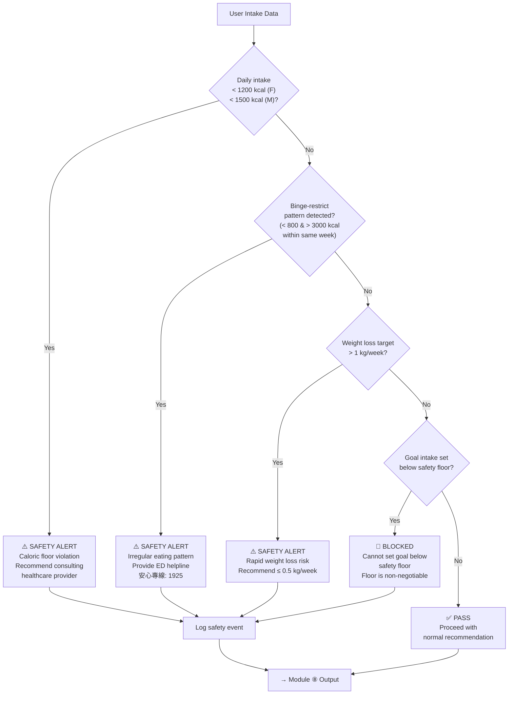
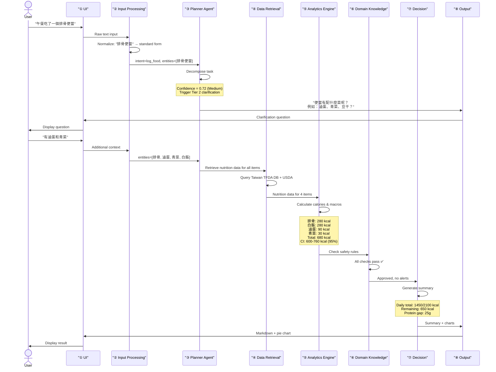

# Design: DietSense 8-Module Architecture

> **Change:** `dietsense-proposal-refactor`
> **Spec:** `dietsense-agent`
> **Status:** Draft
> **Last Updated:** 2025-07-25

## Overview

This document describes the system architecture of DietSense, a conversational AI agent for daily calorie intake analysis and personalized weight management. The architecture comprises eight interconnected modules, each responsible for a distinct concern in the data processing and reasoning pipeline.

---

## 1. Architecture Diagram



---

## 2. Data Flow Diagram

```mermaid
flowchart LR
    User["👤 User"] -->|"'我吃了一碗滷肉飯<br/>加一顆荷包蛋'"| Input["② Input Processing"]
    Input -->|"intent: log_food<br/>entities: 滷肉飯, 荷包蛋"| Planner["③ Planner Agent"]
    Planner -->|"Task 1: lookup 滷肉飯<br/>Task 2: lookup 荷包蛋<br/>Task 3: check portion"| Data["④ Data Retrieval"]
    Data -->|"滷肉飯: 500kcal/bowl<br/>荷包蛋: 90kcal/egg"| Analytics["⑤ Analytics Engine"]
    Analytics -->|"Total: 590 kcal<br/>CI: 520–660 kcal<br/>P: 22g, C: 68g, F: 24g"| Domain["⑥ Domain Knowledge"]
    Domain -->|"Within guidelines ✓<br/>No safety alerts"| Decision["⑦ Decision"]
    Decision -->|"Summary + charts"| Output["⑧ Output"]
    Output -->|"Markdown response<br/>+ pie chart"| User
```



---

## 3. Module Detailed Design

### Module ① — User/Application Scenario

**Purpose:** Provide the user-facing interface for food logging and nutritional queries.

**Input Channels:**
- Text input via mobile app (iOS/Android), web interface, or messaging bots (LINE, Telegram).
- Voice input via built-in microphone, processed by Module ②.

**Key Design Decisions:**
- Multi-platform support to maximize user accessibility.
- LINE Bot prioritized for Taiwan market penetration (LINE has >90% market share in Taiwan).
- Stateless frontend; all session state managed by Module ③.

**Related Requirements:** DR-07 (Conversational AI rationale), NFR-02 (Language support)

---

### Module ② — Query/Input Processing

**Purpose:** Convert raw user input (text or voice) into structured, normalized queries with intent classification.

**Components:**

| Component | Technology | Function |
|-----------|-----------|----------|
| Whisper STT | OpenAI Whisper (large-v3) | Speech-to-text for voice input, supporting Mandarin Chinese and Taiwanese Hokkien |
| Language Normalizer | Custom NLP pipeline | Handle Traditional/Simplified Chinese conversion, colloquial expressions (e.g., "魯肉飯" → "滷肉飯"), unit normalization |
| Intent Classifier | LLM-based / Fine-tuned BERT | Classify into: `log_food`, `query_nutrition`, `analyze_diet`, `get_recommendation`, `update_profile`, `chitchat` |

**Intent Classification Taxonomy:**

```
log_food          — "我今天午餐吃了排骨便當"
query_nutrition   — "雞胸肉100克有多少蛋白質？"
analyze_diet      — "我這週的飲食均衡嗎？"
get_recommendation — "晚餐應該吃什麼來補足蛋白質？"
update_profile    — "我最近開始跑步了，每週三次"
chitchat          — "你覺得珍珠奶茶好喝嗎？"
```

**Related Requirements:** DR-02 (Ambiguous food resolution), NFR-02 (Language support)

---

### Module ③ — Planner & Reasoning Agent

**Purpose:** Serve as the central coordinator that decomposes user requests into executable tasks, manages multi-turn dialogue, and triggers clarification when needed.

**LLM Options:**

| Model | Strengths | Weaknesses | Cost (per 1M tokens) |
|-------|-----------|------------|---------------------|
| GPT-4o | Best reasoning, function calling | Highest cost | ~$5 input / $15 output |
| Gemini 1.5 Pro | Long context (1M tokens), multimodal | Slightly weaker Chinese | ~$3.5 input / $10.5 output |
| Claude 3.5 Sonnet | Strong reasoning, safety | API availability in Taiwan | ~$3 input / $15 output |

**Multi-turn Memory Architecture:**
- **Short-term:** Current conversation context (sliding window, last 20 turns).
- **Medium-term:** Current session summary (compressed by LLM at session end).
- **Long-term:** User profile + dietary history (stored in vector DB + structured DB).

**Task Decomposition Example:**

```
User: "我剛吃了夜市的蚵仔煎和一杯珍珠奶茶"

Decomposed Tasks:
  1. [RETRIEVE] Look up "蚵仔煎" in Taiwan Food DB
  2. [RETRIEVE] Look up "珍珠奶茶" in Taiwan Food DB
  3. [CLARIFY] Ask about 珍珠奶茶 size (small/medium/large)
  4. [COMPUTE] Calculate total calories and macros
  5. [ANALYZE] Compare against daily intake so far
  6. [RESPOND] Generate summary with uncertainty ranges
```

**Clarification Trigger Logic:**



**Related Requirements:** DR-02, DR-03 (Accuracy–UX balance), DR-06 (Architecture selection), TO-1

---

### Module ④ — Data Acquisition/Retrieval

**Purpose:** Retrieve nutritional data from multiple sources and merge results.

**Data Sources:**

| Source | Coverage | Access Method | Update Frequency |
|--------|----------|--------------|-----------------|
| USDA FoodData Central | ~380,000 foods, US-centric | REST API | Quarterly |
| Taiwan TFDA Food Composition DB | ~2,500 foods, Taiwan-specific | Local DB (imported) | Annual |
| Night Market Food KB | ≥100 items, DietSense-constructed | Local DB | As needed |
| Vector RAG Store | Indexed food descriptions + contexts | Embedding similarity search | Continuous |
| User History | Past meals, preferences, patterns | Structured DB (PostgreSQL) | Real-time |

**Retrieval Strategy:**
1. **Exact match** in Taiwan TFDA DB (highest priority for local foods).
2. **Semantic search** in Vector RAG store for fuzzy matches.
3. **API call** to USDA FoodData Central for international foods.
4. **Decomposition** into ingredients for compound dishes not found in any DB (see DR-04).

**Related Requirements:** DR-04 (Graceful degradation), DR-08 (Night market food data), NFR-04 (Availability)

---

### Module ⑤ — Analytics Engine

**Purpose:** Perform all nutritional computations, including calorie calculation, macronutrient analysis, metabolic rate estimation, and uncertainty quantification.

#### 5.1 Calorie Calculation

**Core Formula:**

$$E_{item} = \frac{portion(g) \times kcal_{100g}}{100}$$

Where:
- $portion(g)$ = estimated portion size in grams
- $kcal_{100g}$ = energy density per 100g from food database

**Daily Total:**

$$E_{daily} = \sum_{i=1}^{n} E_{item_i}$$

#### 5.2 Macronutrient Analysis

For each food item, compute:
- Protein (g) = $portion(g) \times protein_{100g} / 100$
- Carbohydrates (g) = $portion(g) \times carbs_{100g} / 100$
- Fat (g) = $portion(g) \times fat_{100g} / 100$

Caloric contribution by macro:
- Protein: 4 kcal/g
- Carbohydrates: 4 kcal/g
- Fat: 9 kcal/g

#### 5.3 BMR/TDEE Estimation — Mifflin-St Jeor Formula

**Mifflin-St Jeor (1990)** — Preferred default formula:

$$BMR_{male} = 10W + 6.25H - 5A - 5$$

$$BMR_{female} = 10W + 6.25H - 5A - 161$$

Where:
- $W$ = weight in kg
- $H$ = height in cm
- $A$ = age in years

**Harris-Benedict (1918)** — Alternative:

$$BMR_{male} = 88.362 + 13.397W + 4.799H - 5.677A$$

$$BMR_{female} = 447.593 + 9.247W + 3.098H - 4.330A$$

**Katch-McArdle (1996)** — When body fat % is available:

$$BMR = 370 + 21.6 \times LBM$$

Where $LBM = W \times (1 - BF\%)$ (Lean Body Mass)

**TDEE Calculation:**

$$TDEE = BMR \times AF$$

| Activity Level | Activity Factor ($AF$) |
|---------------|----------------------|
| Sedentary (office job, no exercise) | 1.2 |
| Lightly Active (exercise 1–3 days/week) | 1.375 |
| Moderately Active (exercise 3–5 days/week) | 1.55 |
| Very Active (exercise 6–7 days/week) | 1.725 |
| Extra Active (athlete / physical job) | 1.9 |

**Related Requirements:** DR-01 (Metabolic variation), DR-09 (BMR formula selection), TM-1, TM-4

#### 5.4 Uncertainty Quantification

**Confidence Interval Formula:**

$$CI = \hat{E} \pm z_{\alpha/2} \cdot \sigma_{portion}$$

Where:
- $\hat{E}$ = point estimate of caloric content
- $z_{\alpha/2}$ = z-score for desired confidence level (1.96 for 95% CI)
- $\sigma_{portion}$ = standard deviation of portion size estimates, derived from:
  - Database variance for the food category
  - Description specificity score
  - Historical user portion patterns

**Confidence Scoring:**

| Confidence Level | Score Range | Characteristics | CI Width |
|-----------------|------------|-----------------|----------|
| High | > 0.85 | Exact match, standard portion, branded item | ±10–15% |
| Medium | 0.50–0.85 | Known food, ambiguous portion or preparation | ±15–25% |
| Low | < 0.50 | Unknown food, vague description, compound dish | ±25–40% |

**Related Requirements:** TM-3 (Portion estimation & uncertainty), DR-03 (Accuracy–UX balance)

---

### Module ⑥ — Domain Knowledge Integration

**Purpose:** Encode domain-specific rules, guidelines, and safety constraints that govern the system's recommendations.

**Knowledge Bases:**

| KB | Content | Format |
|----|---------|--------|
| Taiwan Dietary Guidelines (衛生福利部每日飲食指南) | Daily recommended intake by age/sex group | Structured rules |
| Portion Standards | Standard serving sizes for Taiwanese foods (e.g., 1 碗飯 = 200g cooked rice) | Lookup table |
| Safety Rules | Caloric floors, binge-restrict patterns, rapid weight loss thresholds | Rule engine |
| Food Substitution | Nutritionally equivalent food swaps (e.g., 白飯 → 糙米飯 → 地瓜) | Graph DB |

**Related Requirements:** DR-10 (Safety mechanisms), TM-5 (Behavioral context), TO-2 (Personalization vs. guidelines)

---

### Module ⑦ — Decision/Recommendation

**Purpose:** Synthesize analytics results and domain knowledge into actionable recommendations.

**Output Types:**

1. **Daily Intake Summary:**
   - Total calories consumed vs. TDEE target
   - Macronutrient breakdown (actual vs. recommended)
   - Remaining caloric budget for the day

2. **Gap Analysis:**
   - Identify nutrient deficits (e.g., "You've only consumed 40g protein today; target is 65g")
   - Suggest specific foods to fill gaps

3. **Food Substitution:**
   - Lower-calorie alternatives (e.g., "Consider 蒟蒻麵 instead of 意麵 to save ~200 kcal")
   - Higher-protein alternatives for users targeting muscle gain

4. **Safety Alerts:**
   - Triggered by Module ⑥ Safety Rules Engine
   - Non-negotiable: cannot be dismissed or overridden by user

**Related Requirements:** DR-10 (Safety), TM-1 (Energy balance), TM-2 (Macronutrient composition)

---

### Module ⑧ — Output & Interaction

**Purpose:** Render the system's analysis and recommendations in user-friendly formats.

**Output Formats:**

| Format | Use Case | Technology |
|--------|----------|-----------|
| Markdown Text | Primary response, explanations, recommendations | LLM-generated |
| Pie Chart | Macronutrient distribution (P/C/F ratio) | Chart.js / Matplotlib |
| Trend Chart | Weekly/monthly calorie intake trend | Chart.js / Matplotlib |
| Uncertainty Visualization | Confidence interval display, range bars | Custom SVG |
| Safety Alert Banner | High-priority safety messages | Styled HTML/Markdown |

**Related Requirements:** TM-3 (Uncertainty visualization), NFR-02 (Language support)

---

## 4. Safety Guardrail Design



**Safety Rules Table:**

| Rule ID | Trigger Condition | Action | Override Allowed |
|---------|------------------|--------|-----------------|
| SAFE-01 | Daily intake < 1200 kcal (F) or < 1500 kcal (M) | Display warning + healthcare referral | ❌ No |
| SAFE-02 | Alternating < 800 kcal and > 3000 kcal within 7 days | Display ED warning + helpline | ❌ No |
| SAFE-03 | Weight loss target > 1 kg/week | Suggest safer rate (0.5 kg/week) | ⚠️ Warn only |
| SAFE-04 | User attempts to set caloric goal below floor | Block the setting entirely | ❌ No |
| SAFE-05 | BMI < 18.5 and user requests weight loss | Discourage + refer to healthcare | ❌ No |

**Related Requirements:** DR-10 (Safety mechanisms), TM-5 (Behavioral context)

---

## 5. Component Interaction Sequence



---

## 6. Requirement-to-Module Mapping

| Requirement | Module ① | Module ② | Module ③ | Module ④ | Module ⑤ | Module ⑥ | Module ⑦ | Module ⑧ |
|------------|:--------:|:--------:|:--------:|:--------:|:--------:|:--------:|:--------:|:--------:|
| **DR-01** Individual Metabolic Variation | | | | | ●◎ | ● | ● | |
| **DR-02** Ambiguous Food Resolution | | ● | ●◎ | ● | | | | |
| **DR-03** Accuracy–UX Balance | | | ●◎ | | ● | | | |
| **DR-04** Graceful Degradation | | | ● | ●◎ | ● | | | ● |
| **DR-05** Evidence-Based Validation | | | | | ● | ● | ●◎ | |
| **DR-06** Architecture Selection | | | ●◎ | ●◎ | | | | |
| **DR-07** Conversational AI Rationale | ●◎ | | ● | | | | | ● |
| **DR-08** Night Market Food Data | | | | ●◎ | ● | ● | | |
| **DR-09** BMR Formula Selection | | | | | ●◎ | | ● | ● |
| **DR-10** Safety Mechanisms | | | | | | ●◎ | ●◎ | ● |
| **TM-1** Energy Balance | | | | | ●◎ | | ● | ● |
| **TM-2** Macronutrient Composition | | | | ● | ●◎ | ● | ● | ● |
| **TM-3** Portion Estimation & Uncertainty | | | ● | | ●◎ | | | ● |
| **TM-4** Individual Variation | | | | ● | ●◎ | | ● | |
| **TM-5** Behavioral Context | | | ● | ● | | ●◎ | ● | |
| **TO-1** Accuracy vs UX | | | ●◎ | | ● | | | |
| **TO-2** Personalization vs Guidelines | | | | ● | ● | ●◎ | ● | |
| **TO-3** AI vs Hardware | | ● | | | ●◎ | | | |

> **Legend:** ●◎ = Primary responsible module | ● = Contributing module

---

## 7. Technology Stack Summary

| Layer | Technology | Rationale |
|-------|-----------|-----------|
| LLM Coordinator | GPT-4o / Gemini 1.5 Pro | Best reasoning + function calling capabilities |
| STT | OpenAI Whisper large-v3 | State-of-the-art Mandarin recognition |
| Vector Store | Pinecone / Weaviate | Semantic search for food descriptions |
| Structured DB | PostgreSQL | User profiles, food composition tables, meal logs |
| Food APIs | USDA FoodData Central, Taiwan TFDA | Authoritative nutritional data |
| Charting | Chart.js / Matplotlib | Pie charts, trend lines, CI visualization |
| Frontend | React Native (mobile) / Next.js (web) | Cross-platform with shared logic |
| Messaging | LINE Messaging API | 90%+ market share in Taiwan |
| Deployment | AWS / GCP | Scalability and Taiwan region availability |

---

## 8. Key Design Decisions Log

| # | Decision | Rationale | Trade-off Reference |
|---|----------|-----------|-------------------|
| 1 | Mifflin-St Jeor as default BMR formula | Most validated for modern populations (Frankenfield et al., 2005) | DR-09 |
| 2 | RAG + LLM hybrid architecture | Balances accuracy (structured retrieval) with flexibility (LLM reasoning) | DR-06, TO-3 |
| 3 | Tiered clarification (3 tiers) | Optimizes accuracy–UX balance based on confidence score | TO-1, DR-03 |
| 4 | Progressive personalization | Avoids cold-start problem while enabling individual optimization over time | TO-2 |
| 5 | Text-only input (no hardware) | Maximizes accessibility and adoption; hardware deferred to v2 | TO-3 |
| 6 | Non-overridable safety floors | Ethical mandate; no caloric recommendation below 1200/1500 kcal | DR-10 |
| 7 | LINE Bot as primary channel | Taiwan market penetration strategy | DR-07 |
| 8 | 95% CI for uncertainty display | Standard statistical practice; understandable to lay users | TM-3 |

---

## Revision History

| Version | Date | Author | Changes |
|---------|------|--------|---------|
| 0.1 | 2025-07-25 | DietSense Team | Initial 8-module architecture design |
