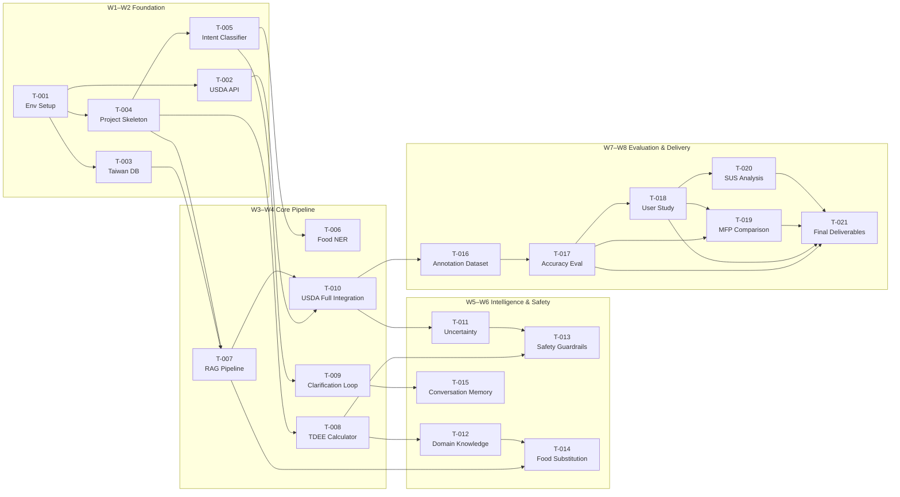

# DietSense — Implementation Tasks

> **Change:** `dietsense-proposal-refactor`
> **Timeline:** 8 Weeks (W1–W8)
> **Effort Unit:** Person-Hours (ph)

---

## W1–W2: Foundation （基礎建置）

- [ ] T-001: Development Environment Setup
- [ ] T-002: Database Initialization — USDA API Integration
- [ ] T-003: Database Initialization — Taiwan Food DB Import
- [ ] T-004: Project Skeleton with 8-Module Structure
- [ ] T-005: Basic Intent Classifier

### T-001: Development Environment Setup
| Field | Value |
|---|---|
| **Module** | All (①–⑧) |
| **Hours** | 8 ph |
| **Dependencies** | — |
| **Description** | Set up Python 3.11+ environment with virtual env. Install core dependencies: LangChain / LlamaIndex, FastAPI, ChromaDB / Weaviate, OpenAI SDK, HuggingFace Transformers. Configure `.env` for API keys (OpenAI, USDA). Set up Git repository with branch strategy. |
| **Acceptance Criteria** | `pip install -r requirements.txt` succeeds; `pytest` runs with 0 errors; `.env.example` documents all required keys; CI lint check passes. |

### T-002: Database Initialization — USDA API Integration
| Field | Value |
|---|---|
| **Module** | ⑤ Analytics Engine |
| **Hours** | 12 ph |
| **Dependencies** | T-001 |
| **Description** | Integrate USDA FoodData Central API (`api.nal.usda.gov/fdc/v1`). Implement search endpoint wrapper, nutrient lookup, and local caching layer (SQLite). Map USDA nutrient IDs to internal schema (energy_kcal, protein_g, fat_g, carbs_g, fiber_g). |
| **Acceptance Criteria** | `search("chicken breast")` returns ≥ 5 results with calorie data; cached queries return in < 50 ms; API rate limiting respected (≤ 30 req/min). |

### T-003: Database Initialization — Taiwan Food DB Import
| Field | Value |
|---|---|
| **Module** | ⑤ Analytics Engine |
| **Hours** | 10 ph |
| **Dependencies** | T-001 |
| **Description** | Import Taiwan Food Composition Database (食品營養成分資料庫) — 6,000+ items. Parse official Excel/CSV data. Normalize fields to internal schema. Store in SQLite with full-text search index. Include Traditional Chinese names and aliases. |
| **Acceptance Criteria** | ≥ 6,000 food items loaded; `search("滷肉飯")` returns correct nutrient profile; Chinese full-text search functional; data matches official TFDA source values. |

### T-004: Project Skeleton with 8-Module Structure
| Field | Value |
|---|---|
| **Module** | All (①–⑧) |
| **Hours** | 6 ph |
| **Dependencies** | T-001 |
| **Description** | Create modular project structure following the 8-module architecture: `input/`, `processing/`, `planner/`, `retrieval/`, `analytics/`, `domain/`, `decision/`, `output/`. Each module has `__init__.py`, base classes, and interface definitions. |
| **Acceptance Criteria** | All 8 module directories created with base interfaces; `from dietsense.planner import BasePlanner` imports without error; module dependency graph documented. |

### T-005: Basic Intent Classifier
| Field | Value |
|---|---|
| **Module** | ② Processing Module |
| **Hours** | 14 ph |
| **Dependencies** | T-004 |
| **Description** | Implement intent classifier that categorizes user input into 4 primary intents: `log_food` (記錄飲食), `query_nutrition` (查詢營養), `analyze` (分析飲食), `recommend` (推薦建議). Use LLM-based classification with structured output (JSON mode). Include confidence scoring. |
| **Acceptance Criteria** | ≥ 90% accuracy on 50 hand-labeled Taiwanese food utterances; returns structured `{intent, confidence, entities}` JSON; handles mixed Chinese-English input; latency < 1.5 s. |

---

## W3–W4: Core Pipeline （核心管線）

- [ ] T-006: Food NER Module
- [ ] T-007: RAG Pipeline with Vector Database
- [ ] T-008: Mifflin-St Jeor TDEE Calculator
- [ ] T-009: Clarification Loop Mechanism
- [ ] T-010: USDA FoodData Central API Full Integration

### T-006: Food NER Module
| Field | Value |
|---|---|
| **Module** | ② Processing Module |
| **Hours** | 20 ph |
| **Dependencies** | T-005 |
| **Description** | Implement Named Entity Recognition for food items, quantities, and modifiers from natural language. Extract structured entities: `food_item`, `quantity`, `unit`, `cooking_method`, `brand`. Handle Taiwanese food names, colloquial expressions (e.g., "一碗乾麵加滷蛋"), and implicit portions. Use BERT/SpanBERT fine-tuned on food corpus or LLM-based extraction. |
| **Acceptance Criteria** | F1 ≥ 0.85 on 100-item test set; correctly parses "早餐吃了一個蛋餅加大冰奶" into structured entities; handles compound meals; returns standardized unit (grams). |

### T-007: RAG Pipeline with Vector Database
| Field | Value |
|---|---|
| **Module** | ④ Retrieval Module |
| **Hours** | 18 ph |
| **Dependencies** | T-003, T-004 |
| **Description** | Build Retrieval-Augmented Generation pipeline for Taiwanese cuisine knowledge. Chunk and embed 500+ Taiwanese food descriptions (night market snacks, lunch boxes, traditional dishes) into vector DB (ChromaDB). Implement hybrid search (semantic + keyword). Configure retrieval with re-ranking. |
| **Acceptance Criteria** | `retrieve("蚵仔煎")` returns top-5 relevant items with nutrition data; Recall@5 ≥ 0.90; embedding dimension and chunk strategy documented; end-to-end retrieval < 500 ms. |

### T-008: Mifflin-St Jeor TDEE Calculator
| Field | Value |
|---|---|
| **Module** | ⑥ Domain Knowledge Module |
| **Hours** | 8 ph |
| **Dependencies** | T-004 |
| **Description** | Implement BMR and TDEE calculator using Mifflin-St Jeor equations. Male: `10×W + 6.25×H − 5×A + 5`; Female: `10×W + 6.25×H − 5×A − 161`. Activity factors: Sedentary (1.2), Light (1.375), Moderate (1.55), Active (1.725), Very Active (1.9). Include weight goal adjustment (deficit/surplus). |
| **Acceptance Criteria** | Unit tests pass for 10 reference cases; correctly calculates TDEE for 25-year-old female, 55 kg, 162 cm, moderate activity = ~1,880 kcal; supports weight loss/gain goal adjustment (±250/500 kcal); input validation for physiological ranges. |

### T-009: Clarification Loop Mechanism
| Field | Value |
|---|---|
| **Module** | ③ Planner Module, ⑧ Output Module |
| **Hours** | 14 ph |
| **Dependencies** | T-005, T-006 |
| **Description** | Build proactive clarification system that detects missing or ambiguous information and generates targeted follow-up questions. Triggers: unknown portion size, ambiguous food item, missing cooking method, unclear meal context. Implement multi-turn state tracking to avoid redundant questions. |
| **Acceptance Criteria** | "我吃了麵" triggers portion/type clarification; "吃了一碗牛肉麵" does NOT trigger unnecessary questions; max 2 clarification rounds per input; conversation state correctly persisted across turns. |

### T-010: USDA FoodData Central API Full Integration
| Field | Value |
|---|---|
| **Module** | ④ Retrieval Module, ⑤ Analytics Engine |
| **Hours** | 10 ph |
| **Dependencies** | T-002, T-007 |
| **Description** | Complete USDA API integration with the retrieval pipeline. Implement fallback chain: Taiwan Food DB → Custom Vector DB → USDA API. Unify response schema across all data sources. Handle unit conversion (oz→g, cup→ml). Implement confidence scoring based on data source. |
| **Acceptance Criteria** | Fallback chain works: local hit skips API call; "grilled salmon 200g" returns USDA data with correct kcal; mixed-source queries (e.g., "滷肉飯 with a side of Caesar salad") merge results correctly; source attribution included in response. |

---

## W5–W6: Intelligence & Safety （智慧與安全）

- [ ] T-011: Uncertainty Quantification Module
- [ ] T-012: Domain Knowledge Integration
- [ ] T-013: Safety Guardrails
- [ ] T-014: Food Substitution Recommendation Engine
- [ ] T-015: Multi-Turn Conversation Memory

### T-011: Uncertainty Quantification Module
| Field | Value |
|---|---|
| **Module** | ⑤ Analytics Engine, ⑦ Decision Module |
| **Hours** | 16 ph |
| **Dependencies** | T-010 |
| **Description** | Implement confidence interval estimation for calorie predictions. Formula: `margin = E × (0.1 + (1 − confidence) × 0.5)`. Confidence factors: data source reliability, portion ambiguity, cooking method variance, food matching score. Output range: `[E − margin, E + margin]` with confidence level. |
| **Acceptance Criteria** | "一碗白飯" with high-confidence DB match returns tight interval (e.g., 280 ± 28 kcal); ambiguous "一份炒飯" returns wider interval (e.g., 550 ± 165 kcal); confidence factors are traceable; unit tests cover edge cases. |

### T-012: Domain Knowledge Integration
| Field | Value |
|---|---|
| **Module** | ⑥ Domain Knowledge Module |
| **Hours** | 14 ph |
| **Dependencies** | T-008 |
| **Description** | Integrate dietary guidelines and portion estimation standards. Include: AMDR macronutrient ranges (Carbs 45–65%, Protein 10–35%, Fat 20–35%), Taiwan Daily Dietary Guidelines (每日飲食指南), portion estimation methods (palm method, container volumes, common serving sizes for Taiwanese foods). Build rule engine for nutritional adequacy assessment. |
| **Acceptance Criteria** | System flags meals exceeding 50% daily fat AMDR; "一個便當" maps to standard lunchbox portions (~700 kcal); palm-method estimation documented and implemented; Taiwan dietary guidelines encoded as verifiable rules. |

### T-013: Safety Guardrails
| Field | Value |
|---|---|
| **Module** | ⑦ Decision Module |
| **Hours** | 16 ph |
| **Dependencies** | T-008, T-011 |
| **Description** | Implement safety checks: (1) Caloric floor: daily total < 1,200 kcal → DANGER warning + professional referral suggestion; (2) Eating disorder pattern detection: binge-restrict cycles, extreme restriction, purge language; (3) Medical referral triggers: pregnancy, chronic disease mentions, medication interactions; (4) Disclaimer injection: "本系統非醫療建議" on every output. |
| **Acceptance Criteria** | Daily total 900 kcal triggers DANGER alert with referral text; "我今天不想吃東西" triggers eating disorder screen; pregnancy mention triggers mandatory referral; all outputs include disclaimer; false positive rate < 5% on 50-case test set. |

### T-014: Food Substitution Recommendation Engine
| Field | Value |
|---|---|
| **Module** | ⑥ Domain Knowledge Module, ⑦ Decision Module |
| **Hours** | 12 ph |
| **Dependencies** | T-007, T-012 |
| **Description** | Build recommendation engine that suggests healthier alternatives based on user goals. Consider: calorie reduction, macronutrient balance, cultural appropriateness (Taiwanese food alternatives), taste similarity. Implement swap logic: same food category, similar cuisine style, within ±20% calorie target. |
| **Acceptance Criteria** | "珍珠奶茶" → suggests "無糖綠茶" or "低糖鮮奶茶" with calorie comparison; recommendations respect cultural context (no non-Taiwanese obscure foods); at least 3 alternatives per suggestion; includes calorie delta display. |

### T-015: Multi-Turn Conversation Memory
| Field | Value |
|---|---|
| **Module** | ③ Planner Module |
| **Hours** | 12 ph |
| **Dependencies** | T-009 |
| **Description** | Implement conversation memory with daily meal context tracking. Store: today's food log, running calorie total, user profile (TDEE, goals), recent clarifications. Support cross-turn references ("跟剛剛一樣", "再加一杯咖啡"). Implement session management with daily reset logic. |
| **Acceptance Criteria** | After logging breakfast and lunch, "我今天還能吃多少?" returns correct remaining calories; "跟早餐一樣" correctly references morning entries; daily logs reset at midnight; conversation history persists within session. |

---

## W7–W8: Evaluation & Delivery （評估與交付）

- [ ] T-016: Taiwanese Food Annotation Dataset
- [ ] T-017: Accuracy Evaluation
- [ ] T-018: User Study Execution
- [ ] T-019: MyFitnessPal Baseline Comparison
- [ ] T-020: SUS Score Calculation & Analysis
- [ ] T-021: Final Deliverables Preparation

### T-016: Taiwanese Food Annotation Dataset
| Field | Value |
|---|---|
| **Module** | ⑤ Analytics Engine |
| **Hours** | 20 ph |
| **Dependencies** | T-010 |
| **Description** | Build 500-item annotated dataset of Taiwanese food descriptions with ground-truth calorie values. Categories: night market foods (夜市小吃), lunchbox meals (便當), noodle soups (湯麵), mixed dishes (合菜), beverages (飲料), breakfast items (早餐), hot pot (火鍋), desserts (甜點). Each item: natural language description, food entities, portion, calories (kcal), macronutrients (P/F/C grams), data source. |
| **Acceptance Criteria** | ≥ 500 items with complete annotations; ≥ 8 food categories represented; inter-annotator agreement ≥ 0.85 (Cohen's κ) on a 50-item subset; ground truth sourced from TFDA/USDA/dietitian review; dataset in JSON format with schema documentation. |

### T-017: Accuracy Evaluation
| Field | Value |
|---|---|
| **Module** | All (①–⑧) |
| **Hours** | 16 ph |
| **Dependencies** | T-016 |
| **Description** | Run end-to-end accuracy evaluation on the 500-item dataset. Metrics: Mean Absolute Error (MAE), Mean Absolute Percentage Error (MAPE), ±10% accuracy rate, ±20% accuracy rate, per-category breakdown. Compare against MyFitnessPal manual lookup baseline. Generate evaluation report with visualizations. |
| **Acceptance Criteria** | ±20% accuracy > 85% (expected target); ±10% accuracy > 50%; per-category results tabulated; statistical significance tested (paired t-test); evaluation script reproducible via `python evaluate.py`. |

### T-018: User Study Execution
| Field | Value |
|---|---|
| **Module** | All (①–⑧) |
| **Hours** | 24 ph |
| **Dependencies** | T-017 |
| **Description** | Conduct 20-person × 7-day user study. Participants: university students / office workers in Taiwan. Protocol: Day 1–3 DietSense, Day 4–6 MyFitnessPal, Day 7 comparison survey. Collect: task completion time, recording accuracy, SUS questionnaire, qualitative feedback. IRB-light: informed consent, data anonymization. |
| **Acceptance Criteria** | ≥ 20 participants complete full 7-day protocol; SUS scores computed (target > 70); task completion time measured (target: 60% reduction vs. baseline); qualitative themes coded; all raw data anonymized and archived. |

### T-019: MyFitnessPal Baseline Comparison
| Field | Value |
|---|---|
| **Module** | — (Evaluation) |
| **Hours** | 8 ph |
| **Dependencies** | T-017, T-018 |
| **Description** | Systematic comparison with MyFitnessPal on: (1) Taiwanese food coverage rate, (2) calorie estimation accuracy for local foods, (3) average recording time per meal, (4) user satisfaction (SUS). Document methodology and present comparative results in tables and charts. |
| **Acceptance Criteria** | Coverage comparison on 50 Taiwanese food items documented; recording time compared with statistical test; SUS scores compared; results presented in publication-ready table format. |

### T-020: SUS Score Calculation & Analysis
| Field | Value |
|---|---|
| **Module** | — (Evaluation) |
| **Hours** | 4 ph |
| **Dependencies** | T-018 |
| **Description** | Calculate System Usability Scale scores from user study data. Process 10-item SUS questionnaire per participant. Compute individual scores, mean, std, percentile ranking. Classify adjective rating (Acceptable / Marginal / Not Acceptable). Compare DietSense vs. MyFitnessPal SUS distributions. |
| **Acceptance Criteria** | SUS computation verified against known reference; mean SUS > 70 (expected target); box plot / histogram visualization generated; statistical comparison (Mann-Whitney U test) between systems. |

### T-021: Final Deliverables Preparation
| Field | Value |
|---|---|
| **Module** | All (①–⑧) |
| **Hours** | 20 ph |
| **Dependencies** | T-017, T-018, T-019, T-020 |
| **Description** | Prepare all final deliverables: (1) DESIGN.md update with final results; (2) presentation slides (期末報告); (3) 3-minute video demo showing key user scenarios; (4) GitHub repository cleanup — remove dead code, add docstrings, finalize README.md; (5) package evaluation artifacts (dataset, scripts, raw results). |
| **Acceptance Criteria** | DESIGN.md reflects final evaluation numbers; presentation ≤ 15 slides; video demo ≤ 3 min showing end-to-end flow; GitHub repo has clean commit history, no API keys in code; all evaluation artifacts reproducible. |

---

## Summary

| Phase | Weeks | Tasks | Total Hours |
|-------|-------|-------|-------------|
| Foundation | W1–W2 | T-001 → T-005 | 50 ph |
| Core Pipeline | W3–W4 | T-006 → T-010 | 70 ph |
| Intelligence & Safety | W5–W6 | T-011 → T-015 | 70 ph |
| Evaluation & Delivery | W7–W8 | T-016 → T-021 | 92 ph |
| **Total** | **W1–W8** | **21 tasks** | **282 ph** |

